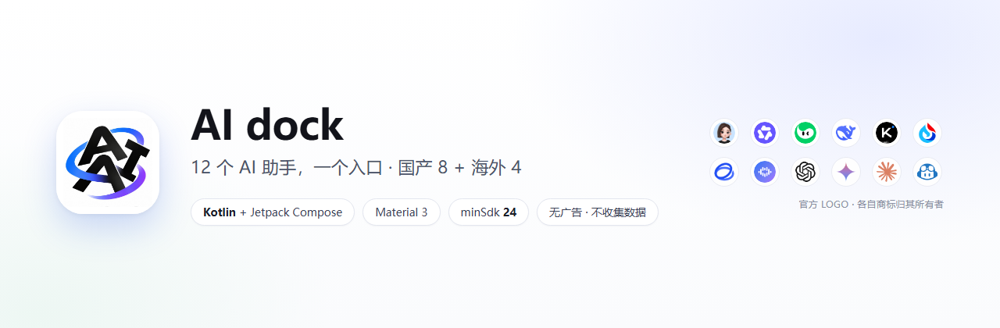
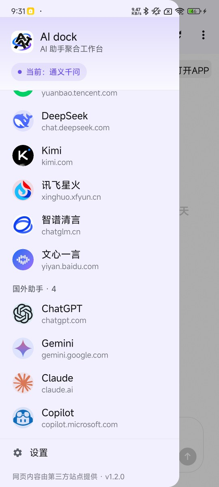
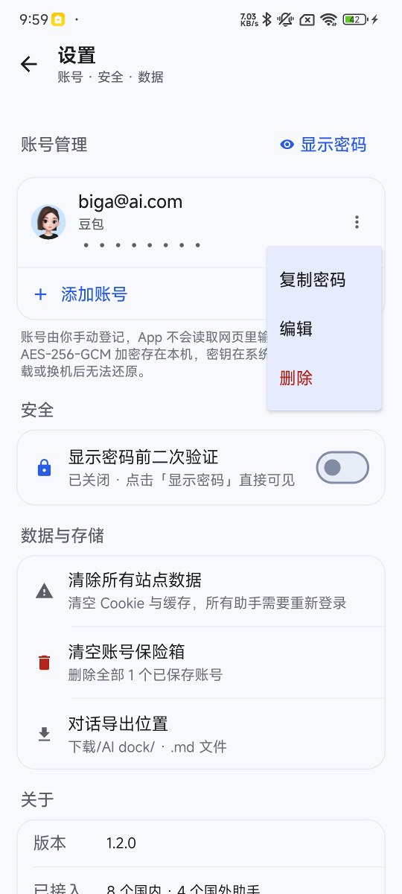
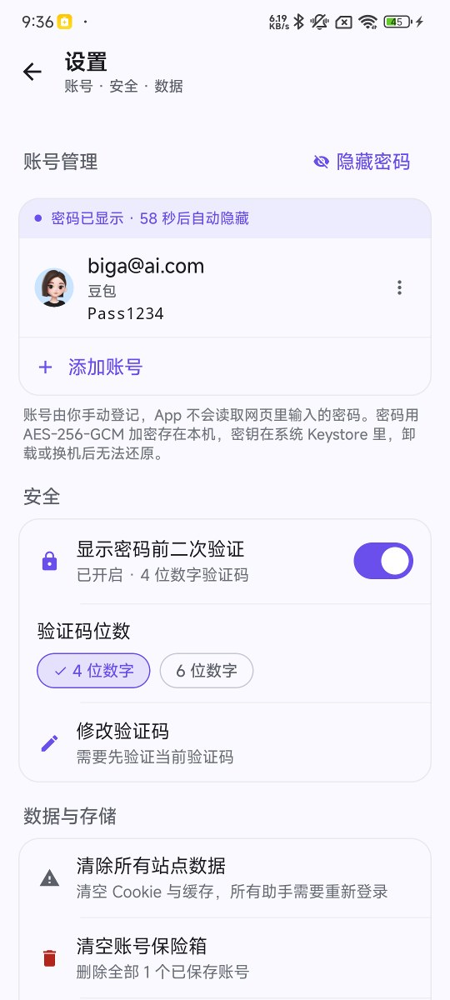
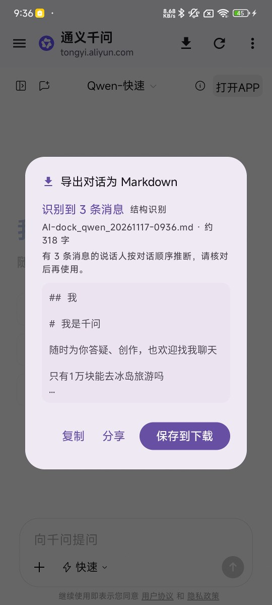
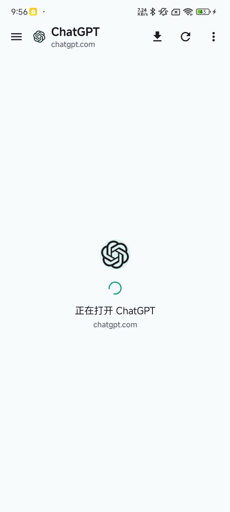
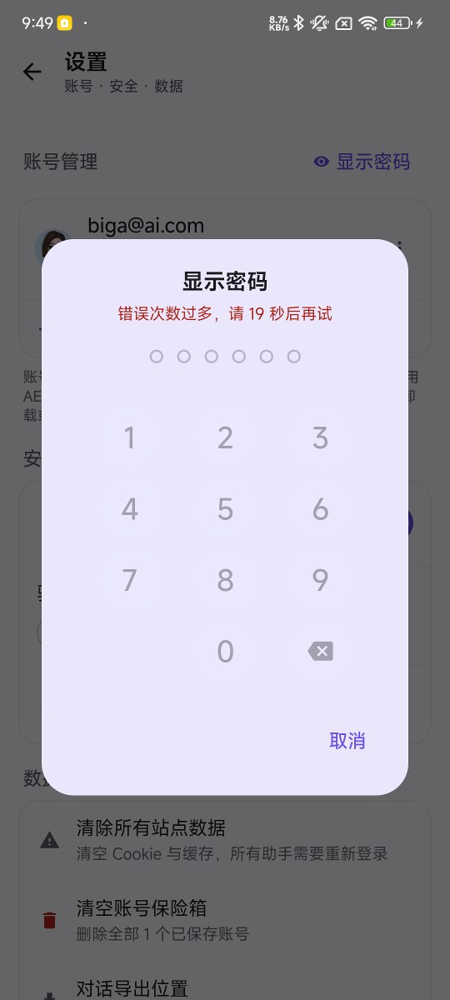
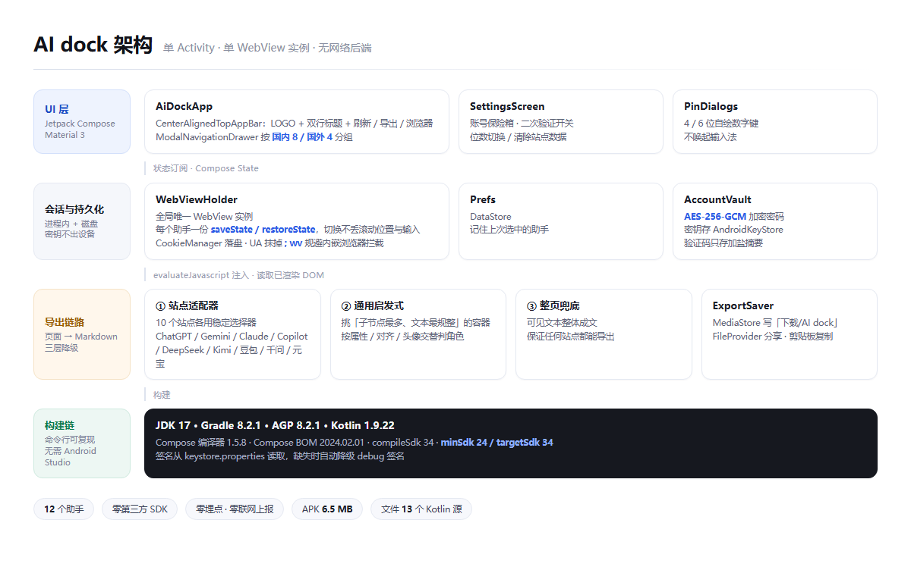

<div align="center">
  
</div>

<div align="center">

**把 12 个国内外 AI 助手装进一个 App。** 不用装 12 个应用，不用记住 12 个图标位置，切换助手像一个 App 里换标签页。

[下载 APK](../../releases/latest) · [技术说明](docs/TECHNICAL.md) · [更新日志](docs/CHANGELOG.md) · [反馈问题](../../issues)


</div>

---

## 为什么做这个

我每天要在豆包、DeepSeek、千问、Kimi 之间来回切：同一个问题想让几个模型都答一遍，对比哪家更靠谱。结果是手机上 12 个图标、12 套登录状态，桌面被塞满，切一次要等一次冷启动。

**AI dock 的思路很朴素**：WebView 就是一个浏览器，把这 12 个站点收进一个壳，共用一个入口。切换时保留各自的会话状态，所以切回来还是刚才那个对话，翻到哪、输入框里打了一半的字，都还在。

它不代理任何请求、不碰你的账号密码、不注入广告，也**没有一行联网上报的代码**——壳只做三件事：显示网页、记住状态、帮你把对话导出成 Markdown。

## 功能

### 一、12 个助手，一个入口

抽屉按 **国内 8 / 国外 4** 分组。每个助手用官方 LOGO，壳层主题色取自该品牌的实际主色，切换时整界面跟着变色，但不会割裂成另一个 App。

| 分组 | 助手 | 域名 | 壳层主色 |
| :-- | :-- | :-- | :-- |
| 国内 | 豆包 | `doubao.com` | `#2B5CE6` |
| 国内 | 通义千问 | `tongyi.aliyun.com` | `#6B4FEC` |
| 国内 | 腾讯元宝 | `yuanbao.tencent.com` | `#02C160` |
| 国内 | DeepSeek | `chat.deepseek.com` | `#4D6BFE` |
| 国内 | Kimi | `kimi.com` | `#1F1F1F` |
| 国内 | 讯飞星火 | `xinghuo.xfyun.cn` | `#D93025` |
| 国内 | 智谱清言 | `chatglm.cn` | `#1444F3` |
| 国内 | 文心一言 | `yiyan.baidu.com` | `#2932E1` |
| 国外 | ChatGPT | `chatgpt.com` | `#10A37F` |
| 国外 | Gemini | `gemini.google.com` | `#4285F4` |
| 国外 | Claude | `claude.ai` | `#D97757` |
| 国外 | Copilot | `copilot.microsoft.com` | `#0F6CBD` |

> 想加新站点只需在 `AssistantCatalog.kt` 里加一条数据 + 一套图标，不用改任何界面代码。

### 二、像原生 App 的 WebView

网页套壳最容易做得很廉价，这里专门处理了几个细节：

- **状态不丢**：全局只保留一个 `WebView` 实例，每个助手一份 `saveState/restoreState` 快照。切走再切回，滚动位置、输入框草稿、弹窗开关状态全部还原，不是简单重载首页。
- **进度与遮罩**：顶部 2dp 细进度条；切换助手时立刻盖一层加载遮罩（当前助手的 LOGO + 进度环），避免"标题已经是 Claude、正文还是豆包"的错位。8 秒没打开会给慢网提示。
- **错误可恢复**：断网、DNS 失败、证书问题都会翻译成中文人话 + 一行技术细节 + 重试按钮，不是白屏。
- **返回键三级**：网页可后退 → 先后退；抽屉展开着 → 先收抽屉；都不是 → 退出 App。
- **下载与跳转**：网页里点下载链接交给系统浏览器处理，不静默失败；`weixin://`、支付宝、应用商店这类非 http(s) 的 scheme 不劫持；`target=_blank` 在当前视图内打开，不跳出 App。
- **更多菜单**：单站点切换桌面版 / 移动版网页（记忆到下次）、清除本站 Cookie 与缓存（不影响账号本）。

### 三、设置页：账号保险箱 + 二次验证

有些站点要单独登录，密码又不好记。设置页提供了一个本地账号本：

| 能力 | 实现 |
| :-- | :-- |
| 密码存储 | **AES-256-GCM** 加密后写入 `vault.json`，密钥由 **AndroidKeyStore** 生成且**不可导出** |
| 二次验证 | 支持 **4 位 / 6 位数字**，自绘数字键盘（不唤起输入法，不会被输入法记录） |
| 显示密码 | 必须通过二次验证；明文只显示 **60 秒**，到时自动回掩码 |
| 防暴力 | 连错 **5 次锁定 30 秒**，锁定期间键盘置灰并倒计时 |
| 关闭保护 | 可以手动关掉，但**关闭和修改验证码本身都要先通过验证**——否则等于没保护 |
| 降级策略 | Keystore 不可用时退到本地随机密钥，界面会标注"非硬件保护" |

验证码本身**不存明文**：只保存 4096 轮加盐 SHA-256 摘要，所以即使把 `vault.json` 拷出来也反推不出验证码。

> 说明：这是"防旁边人瞄一眼"的界面闸门，不是加密保险箱级别的防护，也不替代系统锁屏。

### 四、一键导出为 Markdown

顶栏的下载箭头（或 ⋮ → 导出对话）把**当前对话**导出成 `.md`：标题、站点、时间、消息数、角色分离、代码块带语言标记。

技术上不依赖任何站点的导出接口（它们也没开放），而是往当前页面注入一段 JS，读取**已渲染的 DOM** 再转 Markdown。抽取按三层降级，保证"总能拿到东西"：

1. **站点适配器**：命中已知域名时用该站点的稳定选择器（`data-message-author-role`、`data-testid` 等），已适配 10 个站点；
2. **通用启发式**：没有适配器时，找"子节点最多且文本最规整"的容器当消息列表，再按属性、对齐方式、头像交替推断说话人；
3. **整页兜底**：以上都失败，把整页可见文本作为一段导出。

导出预览会**明说**这次识别到几条消息、走的是哪条路、大概多少字——不假装成功。

保存走 MediaStore 落到 `下载/AI dock/`，也可以直接分享（FileProvider）或复制到剪贴板。

## 截图

> 以下均为真机（1080×2400）实拍，非模拟器、非设计稿。

<div align="center">





<sub>抽屉：国内 8 / 国外 4 分组 ｜ 设置页：账号保险箱 ｜ 验证通过后明文显示 60 秒</sub>

</div>

<div align="center">





<sub>导出预览：消息数 / 来源 / 字数 ｜ 切换站点的加载遮罩 ｜ 连错 5 次锁定 30 秒</sub>

</div>

## 架构

<div align="center">
  
</div>

一句话说清：**单 Activity + 单 WebView 实例 + Compose 重写壳层**，没有网络后端，没有第三方 SDK。

- **UI**：`AiDockApp`（顶栏 / 抽屉 / WebView 容器）、`SettingsScreen`、`PinDialogs`、`Theme`（从一个种子色派生完整的 M3 配色，支持深色模式）
- **状态**：`WebViewHolder`（WebView 生命周期 + 每站点状态快照 + Cookie 持久化）、`Prefs`（DataStore 记住上次选中的助手）
- **数据**：`AccountVault`（加密账号本 + 验证码策略）
- **导出**：`ConversationExporter`（注入 JS + 三层降级 + Markdown 组装）、`ExportSaver`（MediaStore / FileProvider / 剪贴板）

模块边界、关键取舍和踩过的坑都写在 **[docs/TECHNICAL.md](docs/TECHNICAL.md)**。

## 安装

**方式一（推荐）**：到 [Releases](../../releases/latest) 下载 `AI-dock-*.apk`，点击安装。首次安装需允许"安装未知来源应用"。

**方式二**：用 adb

```bash
adb install -r AI-dock-v1.2.0.apk
```

- 系统要求：**Android 7.0（API 24）及以上**，arm64 / armv7 均可
- 从 1.1.x 覆盖升级不需要卸载（签名一致，`applicationId` 未变）
- 应用**不申请**存储权限（Android 10+ 走 MediaStore）、不申请定位、不申请通讯录

## 自己编译

不需要 Android Studio，命令行即可出包：

```bash
# 环境：JDK 17 + Android SDK（platform 34 + build-tools 34.0.0）
export JAVA_HOME=/path/to/jdk-17
echo "sdk.dir=/path/to/android-sdk" > local.properties

./gradlew assembleRelease
# 产物：app/build/outputs/apk/release/app-release.apk
```

**关于签名**：仓库里**没有** release 密钥。把 `keystore/keystore.properties.example` 复制成 `keystore/keystore.properties` 并填入自己的 `storeFile / storePassword / keyAlias / keyPassword`，或直接放一个 `keystore/aidock-release.jks`。没配置时构建脚本会自动降级成 debug 签名——**clone 下来就能装到手机上跑**。

## 目录结构

```
aidock/
├── app/src/main/
│   ├── java/com/aidock/app/
│   │   ├── MainActivity.kt              入口（单 Activity）
│   │   ├── AssistantCatalog.kt          12 个助手的元数据（名称/URL/主色/LOGO）
│   │   ├── data/
│   │   │   ├── AccountVault.kt          账号保险箱 + 验证码策略
│   │   │   └── Prefs.kt                 DataStore
│   │   ├── web/WebViewHolder.kt         WebView 生命周期与状态快照
│   │   ├── export/
│   │   │   ├── ConversationExporter.kt  注入 JS + DOM → Markdown
│   │   │   └── ExportSaver.kt           MediaStore / 分享 / 剪贴板
│   │   └── ui/
│   │       ├── AiDockApp.kt             顶栏 / 抽屉 / WebView 容器 / 导出流程
│   │       ├── SettingsScreen.kt        设置页
│   │       ├── PinDialogs.kt            4/6 位数字键盘
│   │       ├── Components.kt            共用小组件
│   │       └── Theme.kt                 品牌色 → M3 配色
│   └── res/drawable-*/logo_*.png        12 个官方 LOGO × 5 档密度
├── assets/logos/                        图标的原始素材（可复现）
├── tools/                               Java2D 图标工具 + 导出脚本的回归测试
├── keystore/*.example                   签名配置模板（真实密钥不进仓库）
└── docs/                                技术说明 / 更新日志 / README 图片
```

## 已知限制

诚实地列出来，免得你踩：

1. **国外站点在国内网络下打不开**——这是网络环境问题，不是 App 的问题，需要可用的网络环境。
2. **Google 账号登录大概率被拒**——Google 对 WebView 有硬性限制，任何 WebView 壳都解不了。建议用邮箱密码登录 Gemini。
3. **超长对话可能导不全**——这些站点普遍用虚拟滚动，只渲染可视区附近的消息，滚动过远的早期内容不在 DOM 里。导出预览会提示消息数，明显偏少就是撞上这条了。
4. **二次验证不加密账号本**——它只挡"点开就看到明文"这个场景，`vault.json` 的加密靠的是 Keystore 密钥。设备被 root 且攻击者能调用该密钥时，这层保护就没了。
5. **卸载 App 会永久丢失已存密码**——密钥在系统 Keystore 里，随卸载销毁，这是设计而非缺陷。跨设备也不通用。
6. **不做自动填充**——站点登录框结构各不相同，硬做填错的代价比手动复制高。账号本只负责"看得到、复制得出"。
7. **只适配竖屏**——横屏下网页会重排，没有专门优化。

## 版本

当前 **v1.2.0**：新增 ChatGPT / Gemini / Claude / Copilot 四个海外助手；新增设置页（账号保险箱 + 4/6 位二次验证）；新增对话导出 Markdown。完整历史见 [CHANGELOG](docs/CHANGELOG.md)。

## 免责声明

本项目是个人自用的浏览器壳，**与任何 AI 厂商无隶属、无合作关系**。所有产品名称、LOGO、商标归其各自所有者，此处仅用于标识所加载的站点。壳不修改、不代理、不注入任何站点的页面内容，也不收集任何用户数据。

## 许可

暂未选择开源协议。如果你要基于它做分发，请先开 issue 说明用途。
