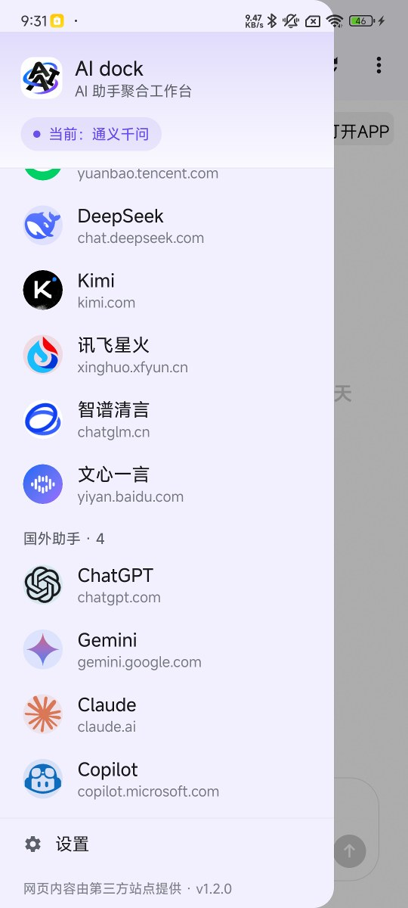
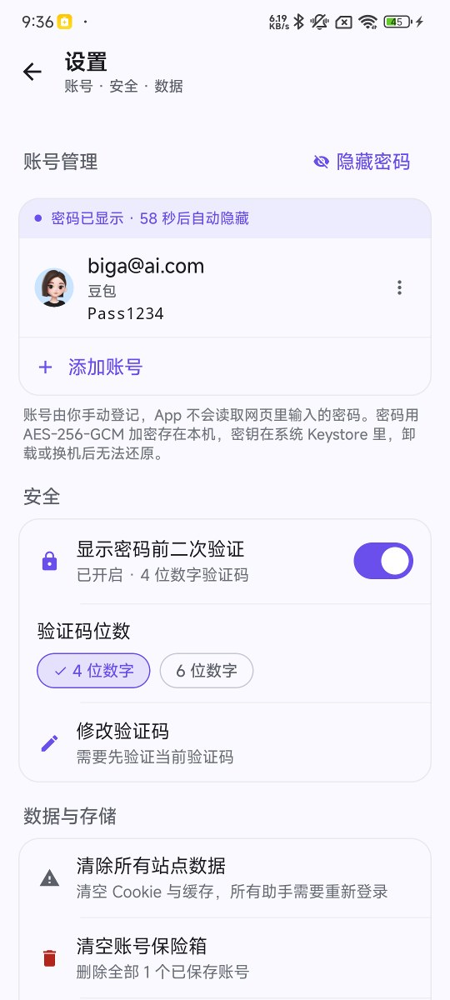
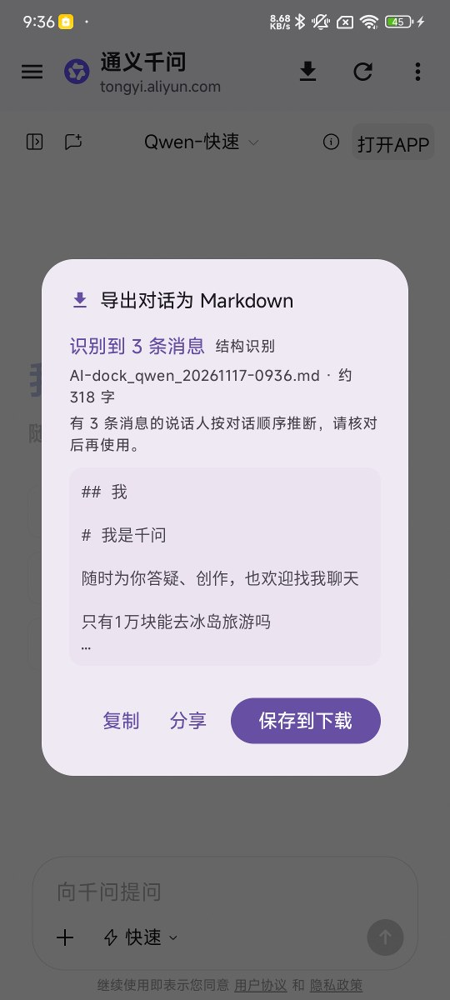

**12 个 AI 助手，一个入口。** 这一版补齐了海外 4 家，加了带二次验证的账号保险箱，并且能把当前对话一键导出成 Markdown。

<div align="center">



</div>

## 新增

**4 个海外助手** — ChatGPT / Gemini / Claude / Copilot。抽屉拆成「国内助手 · 8」和「国外助手 · 4」两组，共 12 个。LOGO 全部取自官方矢量件渲染，不是网图。

**设置页 · 账号保险箱** — 登记站点 / 账号 / 密码 / 备注，可改可删。密码以 AES-256-GCM 加密落盘，密钥在系统 Keystore 里且不可导出。

**二次验证** — 支持 4 位或 6 位数字，自绘数字键盘（不唤起输入法）。点「显示密码」必须验证，明文显示 60 秒后自动回掩码。可以手动关掉，但**关闭和修改验证码本身都要先验证**。

**防暴力** — 连错 5 次锁 30 秒，锁定期间键盘置灰倒计时，重启 App 也不会重置。

**导出对话为 Markdown** — 顶栏下载箭头（或 ⋮ → 导出对话）。带标题、时间、消息数、角色分离、代码块语言标记。抽取走「站点适配器 → 通用启发式 → 整页兜底」三层降级，已适配 10 个站点，其余站点也能导出。可保存到 `下载/AI dock/`、分享、复制。

**加载遮罩** — 切换助手时立刻覆盖，不再出现"标题已换、正文还是上一个站点"的错位；8 秒没打开会给慢网提示。

**其它** — 按站点记忆的桌面版/移动版切换、清除本站数据、关于页。

## 修复

- 保存账号时崩溃：Keystore 不允许调用方自带 IV，改由 Keystore 生成后回读
- 锁定期间重开验证弹窗仍可输入：验证结果没回写内存快照
- 导出的代码块缩进被压平，Python 代码不可运行
- 切换站点时标题与正文错位

## 安装

下载下方的 `AI-dock-v1.2.0.apk` 直接安装。首次需允许「安装未知来源应用」。

```bash
adb install -r AI-dock-v1.2.0.apk
```

- 系统要求：Android 7.0（API 24）及以上
- 签名与 1.1.x 一致，**可直接覆盖升级，不用卸载**
- 不需要存储、定位、通讯录权限

## 已知限制

- **国外站点在国内网络下打不开**，需要可用的网络环境，这不是 App 的问题
- **Google 账号登录会被 Google 拦**（WebView 硬限制，任何壳都解不了），建议用邮箱密码登录 Gemini
- **超长对话可能导不全**：这些站点用虚拟滚动，只渲染可视区附近的消息，滚远的内容不在 DOM 里。导出预览会显示识别到几条，明显偏少就是撞上这条

---

| | |
| :-- | :-- |
| 文件 | `AI-dock-v1.2.0.apk` |
| 大小 | 6,480,948 字节（6.18 MiB） |
| SHA-256 | `258a8b26ec3e41c2ca245dd14817d4c1e033c82d55db267eb1e3a6f3d9209e7f` |
| versionCode / versionName | `4` / `1.2.0` |
| 签名 SHA-1 | `918136d8e8fdf61924cc970399ab0bbfe026d84c` |
